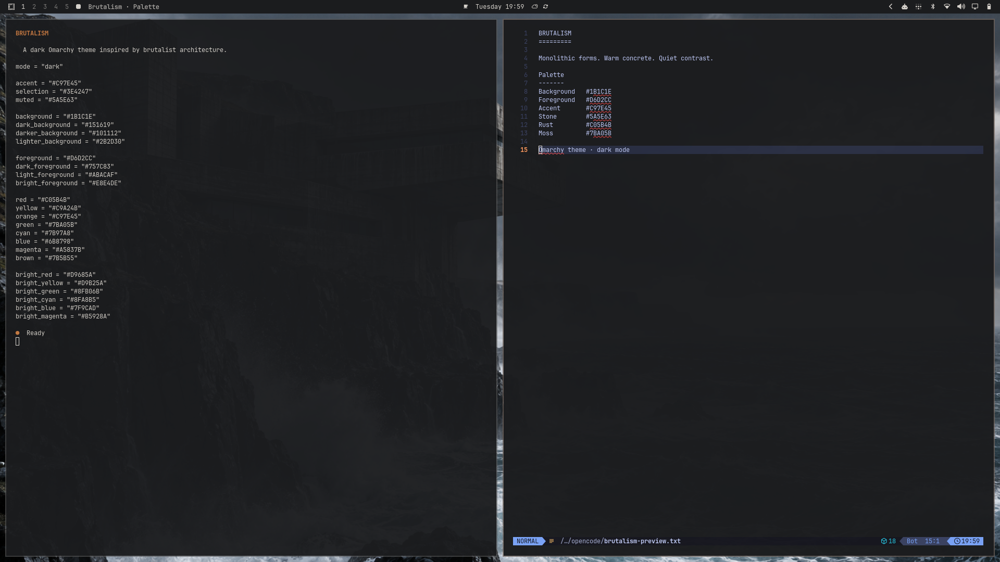

# Brutalism for Omarchy

A dark Omarchy theme inspired by brutalist architecture: concrete grays, restrained contrast, and a warm amber accent. Includes six architectural wallpapers.

## Install

```sh
omarchy theme install https://github.com/idoberyan/omarchy-brutalism-theme
omarchy theme set Brutalism
```

The theme provides a `colors.toml` palette, wallpapers, and optional icon, keyboard, and lock-screen colors. Omarchy derives application-specific colors from the palette.

## Preview


